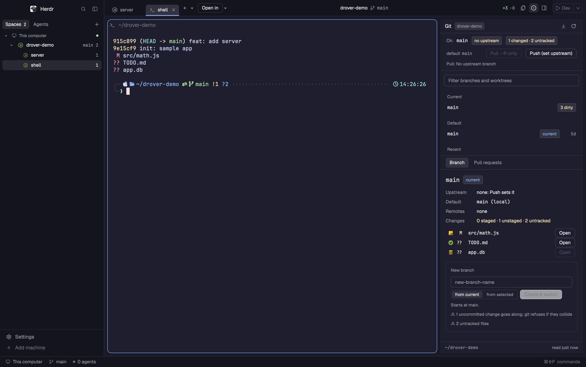

# drover

A workbench for running several coding agents at once. A 268px sidebar on the left lists your spaces with their tabs, panes and agents. A 42px tab bar runs along the top with a run button at its right end. Every pane sits in its own rounded frame with a 28px header that names the agent and shows its status. A side panel on the right, hidden until you open it, switches between sixteen pages, from a file tree and a review list to ports, pull requests, git and a phone simulator. A 28px status row closes the window at the bottom.



## What you see

The window has no title bar. The macOS window buttons sit at 12, 16 and terminals get 14px by 12px of padding. A 1px line in the theme's border color separates the sidebar from the work area.

The sidebar is 268px wide on the theme's chrome background. It can shrink to 44px or grow to 480px. From the top:

- A 46px brand block from Herdr's `workspace-chrome` mod. You drag the window by it.
- A 34px strip with one tab per sidebar view, Spaces and Agents, plus the sort control.
- The view itself. Spaces shows each space with its project type's icon, its open tabs under it, the panes of a split tab, and each agent with how long it has been in its status. Agents shows the agents grouped or by priority, sub-agents under their parent.
- A 69px footer, again from `workspace-chrome`.

The work area starts with the 42px tab row. The tab bar takes the width. Next to the tabs are pinned buttons for side panel pages, a Panels button, a small chip with the lines added and removed against HEAD, and a centered title with the space and its branch, which hides first when the tabs need the room. At the right end a 108px block holds the run button for your saved commands and a menu arrow beside it.

Below it the panes of the active tab, with 8px of padding around them and 8px between them. Each pane has the theme's background, a 1px border, a 1px accent border when it has focus, and 10px corners. Its 28px header shows the program's icon, the agent name or terminal title, the folder, the agent's status, a count of sub-agents when there are any, and buttons to split, zoom and close.

The side panel is 368px wide (280 to 900) and starts hidden. It shows one page at a time: Herdr's Files, drover Files, Herdr's Changes, Review, SQLite, TODO, Inbox, Overview, Ports, Pull requests, Git, Worktrees, Agents, Projects, History and Simulator.

The 28px status row holds Herdr's `workspace-status` across its width, plus two 0px blocks that draw nothing and only listen for keys.

## How it behaves

Agent status uses the theme's status colors. In the sidebar a tab carries a dot in the color of its agent's status, working, blocked or done, and no dot while idle. A folded space shows a dot only when an agent inside is blocked or done. The pane header shows it too, and Overview spins working agents, puts blocked ones first and draws idle ones as a hollow ring.

- Click a space or tab in the sidebar to show it. Right-click for its menu. The chevron folds a space or a machine. Up and Down move, Left and Right fold, Enter opens.
- A tab split into panes lists each pane under it. Click one to focus it.
- In the tab bar, a pinned button opens its panel page, and clicking it again closes the panel. Panels opens a popup with every page in groups, where the pin adds or removes a button. The new-tab menu lists Shell, the agents you have installed and your own templates. The Open in menu opens the space's folder in one of your installed editors. Clicking the diff chip toggles Changes.
- The run button starts the command you ran last, through `sh -c`, in a new tab in the focused folder. Its arrow lists the others and lets you add or edit one. The list is shared state, so every window sees it.
- A pane header's sub-agent count opens a list of everything that agent started, each with its own status.
- Right-clicking a terminal opens Herdr's menu with one extra item, Open selection, which hands the selected text to the Open with chooser.

Keys, all in `keys.json`:

- `cmd-k` Go to: one search field over spaces, tabs, agents, panel pages and drover commands.
- `cmd-shift-b` shows or hides the side panel. `cmd-shift-j` opens the Panels popup.
- `cmd-shift-v` Review, `cmd-shift-e` drover Files, `cmd-alt-y` History, `cmd-alt-s` Simulator.
- `cmd-shift-g` Git, `cmd-shift-o` Projects, `cmd-alt-o` Open with, `cmd-shift-k` Composer, `alt-shift-i` Dispatch.
- `alt-shift-e` equalizes the focused tab's splits, `alt-shift-a` opens the arrangements popup, `alt-shift-s` saves the current split shape, `alt-shift-g` applies a grid.
- `cmd-alt-e` opens the Open in menu.
- In the inbox, agent tree, pane header and actions popups, `cmd-w` closes the popup.

## Built from

```
root (row, titlebar none, traffic_lights [12,16], terminal_padding [14,12], canvas, terminal_menu drover-terminal-menu)
  content (column)
    page-work (row, divider 1 border)
      sidebar (column, 268px, min 44, max 480, chrome)
        brand          workspace-chrome, 46px, window_drag
        sidebar-lists (column)
          sidebar-strip  drover-spaces {strip: true}, 34px
          sidebar-views (stack, active spaces)
            spaces       drover-spaces {tabbed: true}
            agents       drover-agent-tree {tabbed: true}
        sidebar-footer workspace-chrome {footer: true}, 69px
      work (column)
        tabs (row, 42px, window_drag)
          tab-bar   drover-tabs, weight 1
          actions   drover-actions {block: "actions", bar: 42}, 108px
        work-body (row, padding 8, gap 8)
          main      tab active; pane header drover-pane, top, 28px, reveal always;
                    background, border 1 border, focus 1 accent, radius 10, gap 8
          panel (column, 368px, min 280, max 900, hidden)
            panel-body (stack, active files)
              files, drover-files, changes, drover-review,
              data-sqlite (drover-data {view: "sqlite"}), data-todo (drover-data {view: "todo"}),
              drover-inbox, drover-overview, drover-ports, drover-pulls, drover-git,
              drover-worktrees, drover-agents, drover-projects, drover-history, drover-sim
    status-row (row, 28px)
      status             workspace-status, weight 1
      drover-arrange     0px, listens for drover-arrange.* commands
      drover-projects-bg drover-projects {role: "background"}, 0px
```

Shipped Herdr mods it uses: `workspace-chrome`, `workspace-status`, `files`, `changes`. `drover-tabs` and `drover-terminal-menu` began as copies of the shipped `tabs` and `menu` mods. `drover-goto`, `drover-composer`, `drover-dispatch` and `drover-open` have no block; their keys open them as overlays.

What the layout's mods touch, in one place. The single items have their own RECIPE with the details.

- Network: only through git, gh and glab when you fetch, push or list pull requests and issues, through your browser when you open a link, and through Herdr's own link when a space lives on another machine.
- Programs: git (mostly with `--no-optional-locks`), gh, glab, python3 (History's indexer, Review's and Agents' probes), lsof, ps, sysctl, vm_stat, sqlite3, find, ls, test, realpath, stat, mv, mkdir, `/usr/bin/trash`, `open`, rg or grep, zoxide, and for the simulator xcrun, adb, emulator, curl (to the emulator's local gRPC port), sips, open and a small Swift helper that `xcrun swiftc` builds from source on first use. Programs get argument lists. `sh -c` runs only fixed scripts and the commands you save in Actions or Worktrees.
- `hc`: `send` (Composer, Overview's Reply, the Review and Pulls prompts, Dispatch), `label` (Inbox and Overview keep settled and snoozed marks on the agent's terminal), `get`, `read`, and `connect` for Arrange's read of the split tree.
- Reads outside the mods folder: the folders of your spaces, `~/.claude`, `~/.codex` and `~/.pi` transcripts (History, Review, Agents), and the setup folders of the agent CLIs (Agents). Credential files and databases are refused by the viewer, files and Agents.
- Writes: `data/drover-history/` (search index), `data/drover-projects/visits.json`, `data/drover-viewer/` (drafts and an image cache), `data/drover-open/prefs.json`, `data/drover-agents/`, `data/drover-goto/recent.json`, `data/drover-arrange/arrangements.json`, `mods/drover-review/.viewed.json`, simulator frames in `mods/drover-sim-screen/` (the empty companion mod the Simulator panel draws from), and the helper build, saved shots and `simd.json` under `data/drover-sim/`. All of these are under `~/.config/herdr-app`, and the root layout ships `drover-sim-screen` next to `drover-sim`. In your folders it writes only when you ask: saving in the viewer, file operations in Files, Data's edit mode and TODO board, git actions, and new worktrees.

## Watch out

- The side panel's sixteen pages all stay mounted. Each mod checks `layout()` and polls only while its page is on screen and the window is active, or reads at a slow interval. Keep it that way when you add a page.
- Panel pages are chosen with `layout.select` on the `panel-body` stack, so the stack and its child ids must keep these names. The `layout:drover` section of `keys.json` depends on them.
- The two 0px blocks in the status row have to stay in the layout; without them the `drover-arrange.*` and `drover-projects.open` key commands have no copy to answer them.
- `drover-composer` and `drover-dispatch` read the focused terminal or space once, when they open, because after that the dialog itself has focus.
- Move to Trash needs `/usr/bin/trash` from macOS 15 or later. Without it the item is not shown.
- The Simulator page needs Xcode's `xcrun simctl` for iOS or `adb` for Android, and its companion mod `drover-sim-screen` next to it. The live view builds a Swift helper from source with `xcrun swiftc` the first time it is needed; no binary ships. It runs nothing while it is hidden.

## Done when

- The window shows the sidebar, the 42px tab row, framed panes with 28px headers and the 28px status row, and no title bar.
- The sidebar's strip switches between Spaces and Agents, and the tab of a working agent shows a dot in the working color.
- `cmd-shift-b` opens the 368px side panel on Files and closes it again.
- `cmd-shift-v`, `cmd-shift-e`, `cmd-alt-y` and `cmd-alt-s` each open their page in the panel.
- Panels lists all sixteen pages, and pinning one adds its button to the tab bar.
- `cmd-k` opens Go to, and Enter on a space shows that space.
- The run button starts a saved command in a new tab.
- `alt-shift-e` evens out the splits of a tab with three panes.
- Right-clicking a terminal with text selected shows Open selection, and it opens the chooser with that text.
