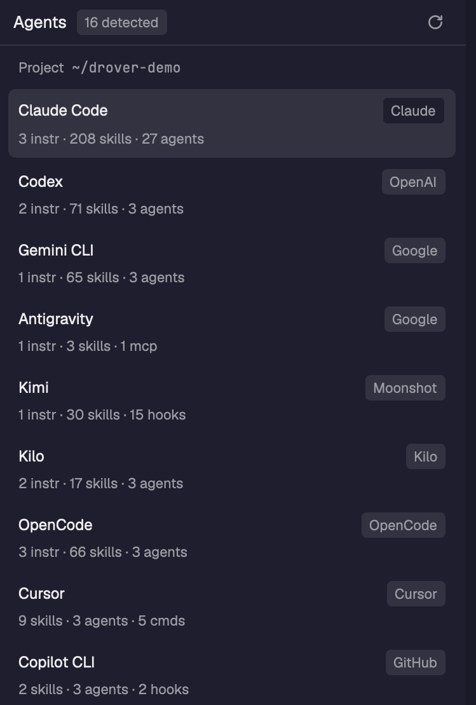

# drover-agents

A page about the coding-agent CLIs on this computer. For each one it lists the setup it would load, globally and for the focused folder: instructions, skills, agents, commands, MCP servers, hooks and plugins. It also shows the focused session's context and cost, and token usage over time for Claude Code and Codex.



## What you see

The header says Agents with "N detected" and a Refresh button. A list on the left, 264px wide, has a row per detected agent, and the chosen one fills the rest of the page. When the page is narrow, the list takes the whole width and a row opens the agent, with "Back to agents" to return. Agents it can find: Claude Code and its cc-mirror variants, Codex, Gemini CLI, Antigravity, Kimi, Kilo, OpenCode, Cursor, Copilot, and skills-only folders such as Qwen Code or Crush.

For the chosen agent:

- Global and Project, each with groups for Instructions, Skills, Agents, Commands, MCP servers, Hooks and Plugins. Ten rows per group, then a button to show all.
- "Session · focused pane": the model, the context used, and an estimated cost of the session in the focused pane.
- Usage: Lifetime tokens, Last 12 weeks as a heat map, Peak day, Top models and Today.

A click on an instruction, skill, agent or command file opens it in a viewer inside the page, read-only. Files over 256 KB show "Truncated at 256 KB". Open in editor hands the file to the system text editor.

## How it behaves

- The list is read again every 60 seconds and when the focused space or folder changes. The session every 30 seconds. Usage at most once a minute.
- None of that runs while the page is hidden or the window is in the background.
- Refresh reads everything now.
- A space on another machine shows "Remote space: not read." The agent files are read on this computer only.

## Built from

One mod, `drover-agents`, `"place": "none"`, a full page. Put it in a layout block, or open it with `mod.open {name: "drover-agents"}`.

Prices for the cost estimate live in `config.json` in the mod folder, in USD per million tokens as `[input, output]`. A model matches when its id contains the key:

```json
{ "prices": { "models": { "sonnet": [2, 10] }, "cacheWrite": 1.25, "cacheRead": 0.1 } }
```

What it touches:

- Network: none.
- Programs: `python3 -I probe.py` for all reading, `git rev-parse` to find the focused folder's repository root, and for Open in editor `open -t <file>` on macOS, `xdg-open <file>` on Linux and `explorer.exe <file>` on Windows. Before that, `realpath` on macOS and Linux makes sure the file a path leads to is not a credential file, and on Windows a PowerShell check refuses a path that goes through a symbolic link or junction. On Windows the probe needs a `python3` on PATH, which a python.org install does not add.
- `hc`: none.
- Reads outside its folder, through `probe.py` only: the agents' config folders in your home folder (such as `~/.claude`, `~/.codex`, `~/.gemini`, `~/.config/opencode`, `~/.cursor`), the focused folder's agent files (`CLAUDE.md`, `AGENTS.md`, `.mcp.json` and the like), and Claude Code and Codex transcripts for token counts. Only names, descriptions, paths and sizes are taken from configs. Env blocks, headers, arguments, tokens and keys are dropped when the file is parsed. Credential files and databases are refused.
- Writes: `.cost-cache-<agent>.json` beside `probe.py`, and `usage-store.json` and `tokens-cache.json` in `data/drover-agents/` under the Herdr config folder. They hold hashed keys and numbers, no paths or text.

## Watch out

- Agent binaries are only checked for existence, never run.
- Usage covers Claude Code and Codex. The first run on a large transcript folder can stop at its time budget, and the next run picks up where it left off.
- Prices for models not in `config.json` stay empty rather than guessed.
- The file viewer asks `probe.py` for an item by its place in the list, never by a path, and redacts strings that look like secrets.

## Done when

- With Claude Code installed, the page lists it with its global skills and MCP servers.
- Focusing a folder with a `CLAUDE.md` shows it under Project, Instructions.
- Clicking that file shows its text in the page.
- With a Claude Code session in the focused pane, the session block shows its model and context.
- Usage shows Lifetime tokens and a 12 week heat map.
