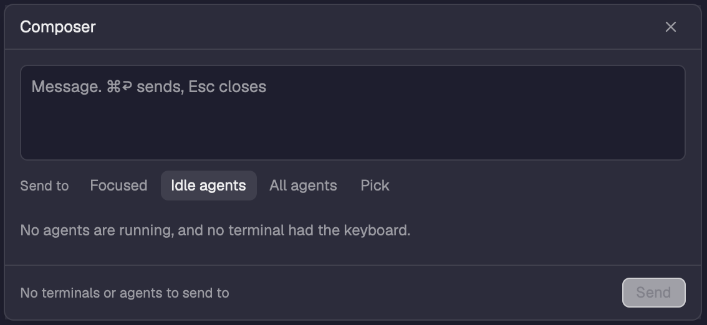

# drover-composer

A small window for writing one message and sending it to the focused terminal or to several agents at once. Each send goes out as if you had pasted the text and pressed Enter.



## What you see

A window 560 wide with a text area of 3 to 12 rows and four target modes: Focused, Idle agents, All agents and Pick. Below the modes, every terminal and agent gets a row with a box that is ticked when it is a target. In Pick, a click on a row ticks or unticks it. The footer shows the targets and the Send button, which says "Send" for one target and "Send to N terminals" for more. After a send, each target shows whether it got the message.

## How it behaves

- The terminal that had the keyboard when the window opened is the Focused target. It is read once, at open.
- Blocked agents are left out and marked "Skipped: needs you", since a message would answer their question.
- More than one target needs a second click: the button turns into "Confirm: send to N terminals" for 5 seconds.
- A target where you have an unfinished line typed shows "Waiting for its draft to clear". The send waits up to 90 seconds.
- A failed target can be sent again. Targets that already got the text are skipped on the retry.
- `cmd-enter` sends on macOS, `ctrl-enter` on Linux and Windows, and Esc closes.

## Built from

One mod, `drover-composer`, `"place": "none"`, with a window overlay 560 wide. The item's `keys.json`:

```json
{ "global": { "cmd-shift-k": "mod.open:drover-composer", "secondary-alt-shift-k": "mod.open:drover-composer" } }
```

What it touches:

- Network: none.
- Programs: none besides `hc`.
- `hc`: `send -- <address> <text>`, one per target, no `--force`.
- Reads outside its folder: the icons of the shipped workspace-chrome mod.
- Writes: nothing. The text is not stored, not even as a draft.

## Watch out

- The send is typed into the terminal. A target running something other than an agent gets the text as typed input.
- Closing the window drops the text.

## Done when

- `cmd-shift-k` (`ctrl-alt-shift-k` on Linux and Windows) opens the window with Focused set to the terminal you were in.
- Typing a line and pressing `cmd-enter` (`ctrl-enter` on Linux and Windows) puts it in that terminal and presses Enter.
- With two idle agents, Idle agents asks for a confirm and then sends to both.
- A blocked agent in All agents shows "Skipped: needs you" and gets nothing.
