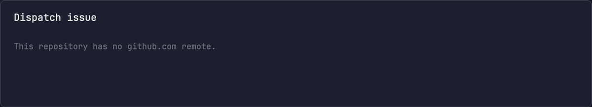

# drover-dispatch

Pick an open GitHub issue of the focused space's repository and get a place to work on it: a git worktree on a new branch, a space on that worktree, and two panes side by side for a worker and a reviewer. It can also start an agent in the worker pane and send it the issue, but only if you ask, with a second click.



## What you see

A 900 by 620 dialog titled "Dispatch issue". On the left, the open issues with a "Filter issues" field and an "Assigned to me" toggle. On the right, the picked issue with its labels, then the plan: the branch name, the worktree folder, and an Agent choice. Below the plan is the first message the agent would get, marked "sent only if you start an agent".

## How it behaves

- The space is fixed when the dialog opens. Set up then moves focus to the new space.
- The proposed branch is `issue-<n>-<slug>`, and you can edit it. A bad name gets a reason, such as "A name can't start with '-'."
- Set up runs `git worktree add --no-track -b <branch> <path> <base>` into `<repo>/.claude/worktrees/<branch>`. The base is the default branch, or main, or master. It then creates a space named `#<n> <title>` (the title cut at 32 characters) on the worktree and splits it: worker on the left, reviewer on the right.
- If the worktree is already there, the button says Open existing and only opens a space on it.
- Start agent turns into "Confirm: start and send". The second click types the agent command into the worker pane, waits up to 30 seconds for it to come up, and then sends the first message only if the agent is idle. The message names the issue, its URL, and asks the agent to read it with `gh issue view`.
- `alt-shift-i` opens the dialog.

## Built from

One mod, `drover-dispatch`, `"place": "none"`, with a dialog overlay of 900 by 620. The item's `keys.json`:

```json
{ "global": { "alt-shift-i": "mod.open:drover-dispatch" } }
```

The agents offered come from `config.json` in the mod folder:

```json
{ "agents": ["claude", "codex"] }
```

Each entry is a command line of plain tokens. The first one is the default.

What it touches:

- Network: GitHub, through `gh` only, and read-only: `gh issue list --repo=<repo> --state open --limit 50 --json ...`, `gh issue view`, `gh api user --jq .login`.
- Programs: git (`--no-optional-locks`, read-only checks, and `worktree add` on Set up), `realpath` and `test -e` / `test -L` to refuse symlinks in the worktree path.
- `hc`: sends the agent command and the first message to the worker pane, and reads its last 20 lines to see the agent is up. Before typing it checks with `hc get --json` that the pane sits at a shell prompt.
- Reads outside its folder: the focused space's repository.
- Writes: the new worktree and branch, on Set up only. A new space with its panes.

## Watch out

- Set up works on macOS and Linux. On Windows it is refused with a one-line reason, because its folder checks use `/` paths, `realpath` and `test`.
- The repository needs a github.com remote and `gh` must be signed in. The dialog says which one is missing.
- The worktrees folder must sit inside the repository and not inside `.git`, and no part of it may be a symlink.
- Starting an agent is off by default. The first message goes out only when the agent shows its prompt and is idle, otherwise nothing is sent and the dialog says so.
- At most 50 open issues are listed.

## Done when

- In a space on a GitHub repository, `alt-shift-i` lists its open issues.
- Picking issue 12 proposes `issue-12-<slug>`, and Set up creates the worktree and a space `#12 ...` with two panes.
- Opening the same issue again offers Open existing.
- Start agent asks for a confirm, and after it the worker pane runs the agent and gets the issue message.
