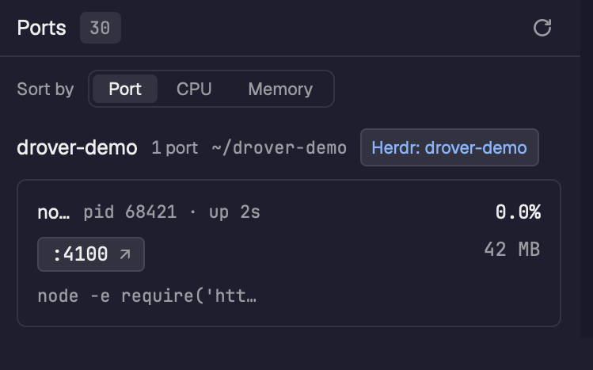

# drover-ports

A dialog of every TCP port listening on this computer. Each row shows the port, the program behind it (name only, never its arguments), its CPU and memory, how long it has run, and the Herdr space it was started from. Rows are grouped by the folder the process runs in. A click on a web port chip opens it in the browser, and Stop ends the process after a second click.



## What you see

A 920 by 640 dialog. Processes are grouped by their working folder. Ports published by a container tool go into a Containers group. A process whose folder is your home folder or `/` goes into a System group, listed last. Long paths keep their tail, as in `…/parent/name`, and are never cut in the middle.

Each row has the program name and folder, one 22px chip per listening port, CPU, memory, run time, and a "Herdr: <space>" badge when the process runs in a Herdr terminal. Each chip shows its kind: web ports show ↗, other ports show `db`, `debug` or `other`. A sort control switches between Port, CPU and Memory.

## How it behaves

- A web port chip opens its address with `open` on macOS, `xdg-open` on Linux and `explorer.exe` on Windows. The host follows the bind: `127.0.0.1` or `[::1]` when only that loopback is bound, `localhost` for a wildcard or both loopbacks. Database, debugger and other ports do not open. Kinds come from a fixed list of ports and program names, and ports are never probed. A process started with `--inspect` counts as a debugger on all of its ports.
- Stop appears when you hover or select a row. It turns into "Confirm stop" for 4 seconds. The second click reads the ports again and sends nothing when the read fails, the port is already free, another process holds it now, or the pid now belongs to a different process (start time moved by more than 2 seconds; macOS and Linux). Then it sends `kill -TERM`, or `taskkill /PID <pid>` on Windows. It never signals pid 1 or lower.
- After the stop it reads the port once a second for up to 10 seconds and says Stopped, Still running, Started again (a watcher may have restarted it) or Could not check. A failed read never counts as stopped.
- Ports published by Docker Desktop, OrbStack, vpnkit or docker-proxy show as Docker with no Stop. Lima, gvproxy and Podman helpers show as Containers, and `wslrelay` on Windows as WSL, also with no Stop. A row whose program is unknown has no Stop.
- Up and Down move the cursor, Enter opens the first web port of the row (nothing when it has none), Esc clears the cursor.
- The list refreshes every 15 seconds while the window is active.
- The sort choice is kept in the mod's localStorage under `sort`.

## Built from

One mod, `drover-ports`, `"place": "none"`, with a dialog overlay of 920 by 640. Open it with `mod.open {name: "drover-ports"}`, for example from a key you add to `keys.json`:

```json
{ "global": { "cmd-alt-l": "mod.open:drover-ports" } }
```

On Linux and Windows `cmd` is the Super or Windows key, so pick a Ctrl chord there instead, such as `ctrl-alt-shift-l`.

It also works as a block in a layout.

What it touches:

- Network: none. A web port chip asks the system to open a local URL (host and port only) in your browser.
- Programs, with argument lists, each with a 4 second timeout (`hc` calls keep their own default):
  - `lsof -iTCP -sTCP:LISTEN -nP` for the ports;
  - `ps -ww -o pid=,pcpu=,rss=,etime=,command= -p <pids>` for the processes (only the program name and an `--inspect` flag are kept from the command line);
  - `lsof -a -d cwd -p <pids> -Fn` for their folders;
  - `ps -axo pid=,ppid=` to walk up to a Herdr shell;
  - `open`, `kill -TERM`; before and after a stop, `lsof -nP -iTCP:<ports> -sTCP:LISTEN` and, before it, `ps -o etime= -p <pid>`.
  - On Linux the same, with `xdg-open` to open. Without lsof it reads `ss -ltnp`, `ps` and `pwdx` instead, and `ss -ltnp` for the stop checks.
  - On Windows, `netstat -ano` and `tasklist /FO CSV /NH`, `explorer.exe` to open, and `taskkill /PID <pid>` between netstat reads. Windows shows no folder, CPU or uptime, and taskkill does not force, so many console programs refuse to close and the page says so.
- Reads outside its folder: nothing beyond what those programs report.
- Writes: nothing. The sort choice lives in localStorage.

## Watch out

- It sees this computer only. Ports on a remote machine of a space do not show.
- The key in the example is not bound by default. Pick one that is free in your `keys.json`.
- Without root, Linux tools do not list a rootful `docker-proxy`, so those ports do not show at all.
- Started again can be a false alarm when an unrelated program takes the port within 10 seconds.

## Done when

- With a dev server running on port 3000 in a Herdr space, the dialog shows it under the project's folder with that space's badge.
- Clicking the 3000 chip opens the page in the browser.
- Stop asks for a second click, and after it the port is gone on the next refresh.
- Stop a server run under a file watcher and the toast says it started again with the new pid, and the new pid's card says Started again for 6 seconds.
- Docker Desktop's ports show as Docker in the Containers group with no Stop.
- A Postgres port shows `db` and does not open; Enter on that row does nothing.
- Sorting by Memory puts the largest process first and the choice is still there after reopening.
