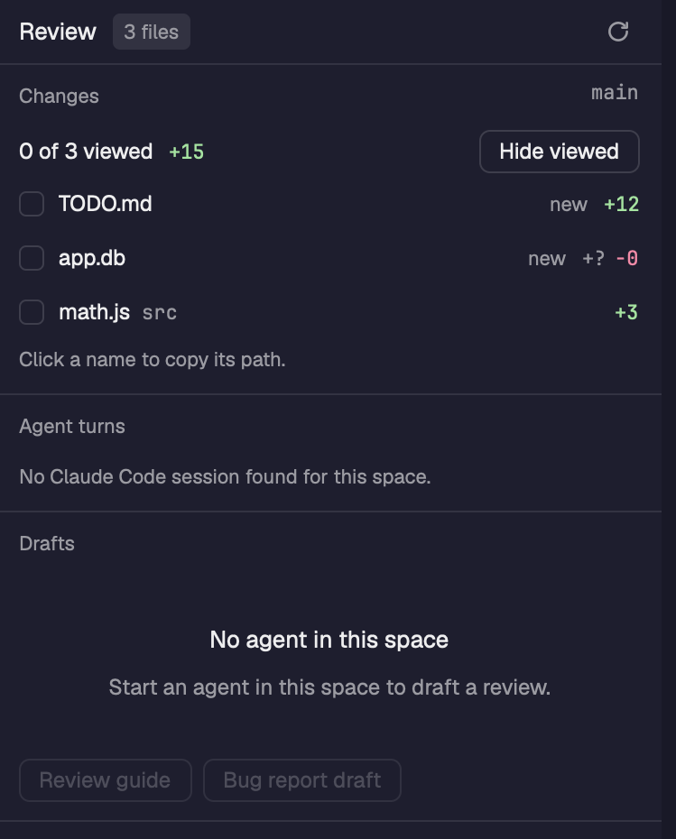

# drover-review

A narrow panel for checking an agent's work in the focused space. It lists the uncommitted changes with a viewed mark per file, shows which files the agent edited in its last few turns, and can hand the agent a prompt that asks for a review guide or a bug report draft.

## What you see

A popup at the top of the window, 350 wide and 85% of the window tall. The header says Review, with the number of files or "Latest turn" as its meta, and a Refresh icon.

- Changes: "N of M viewed" with the total line counts, then one row per changed file with its added and removed lines and a viewed checkbox. Tags mark files that are new, "new, not read", deleted or binary. Hide viewed and Show viewed fold the files you already ticked. Clicking a name copies its path.
- Agent turns: one row per turn, "Latest turn" first, then "1 turn earlier" and so on, each with the number of files it edited. Clicking a turn limits Changes to its files, and All files goes back to the full list.
- Drafts: two buttons, Review guide and Bug report draft.

With no folder it says "Focus a terminal to show its folder here." Outside a git checkout, or with no agent in the space, the Drafts section says why it can't run.

## How it behaves

- A draft button shows its prompt on the first click, with "Click again to send." and Cancel. The second click sends it to the agent with `hc send`. Both prompts ask the agent to show the result and stop.
- Drafts need exactly one agent in the space. With two or more, the buttons stay off.
- A viewed mark holds until the file changes again. Then the mark drops by itself.
- git is read on focus change, every 10 seconds and on Refresh. The turns are read on focus change, every 20 seconds and on Refresh. Neither runs while the panel is hidden or the window is in the background.
- The last 5 turns are kept and at most 300 rows are drawn.

## Built from

One mod, `drover-review`, `"place": "none"`, size 340, with a popup overlay at the top, offset 40. Open it with `mod.open {name: "drover-review"}` from a key you add to `keys.json`, or put it in a layout block.

What it touches:

- Network: none.
- Programs:
  - git with read-only argument lists (status, numstat and diff) in the focused folder;
  - `stat`, in BSD or GNU form, to notice file changes;
  - `python3 -I probe.py turns` to read the agent's turns;
  - `hc send -- <agent> <prompt>`, only on the second click of a draft button, with a 90 second timeout. If hc gives no answer in time, the panel says the prompt may still arrive.
- Reads outside its folder: the focused space's checkout, and Claude Code transcripts under `~/.claude/projects` (or `CLAUDE_CONFIG_DIR`). The transcript is read from its end in 512 KB steps up to 8 MB, and only edit tool calls are kept. Prompt text is never read into the panel.
- Writes: `mods/drover-review/.viewed.json` for the viewed marks. Nothing else.

## Watch out

- Git and Herdr's `hc` must be on PATH; the panel says so when one is missing. On Windows the turns are read with `py -3` (or `python3`), and line counts for new files need `stat` from Git for Windows' `usr\bin` folder.
- The turns come from Claude Code transcripts only. Other agents still get the Changes list and the drafts, but no Agent turns.
- On a space on another machine, git runs there. Agent turns shows only the note "Remote space: the agent's transcript is read on this computer only."

## Done when

- In a space with uncommitted changes, Changes lists each file with its line counts.
- Ticking a file and hiding viewed files removes it from the list. Editing that file again brings it back unticked.
- After a Claude Code turn that edited two files, Latest turn lists those two.
- Review guide shows the prompt on the first click and sends it to the agent on the second.
