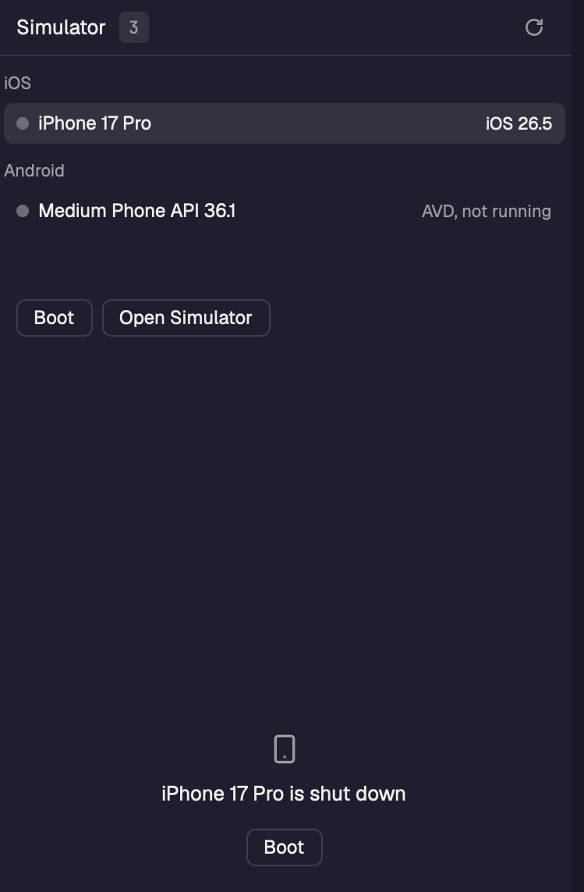

# drover-sim

A Simulator panel for a booted iOS Simulator or a running Android emulator. You see the device screen, tap it, drag across it, scroll it and type into it, and a list beside the picture lets you boot or shut down devices. A physical Android device shows too, as a slower picture. It needs a second, empty mod next to it, `drover-sim-screen`, which only holds the picture files.

## What you see

The panel header says Simulator and shows how many devices it found, with a Refresh button. Under it is a device list in two sections, iOS and Android. iOS lists booted simulators first, then shut-down ones of the newest iOS runtime, 12 at most. Android lists what `adb devices` reports, then the AVDs that are not running. Click a row to show that device. The choice is kept for the window.

Below the list is the screen picture, and a footer line with the device name, the frame rate and the picture size. Without a device the panel says "No simulators or devices". Without Xcode and without adb it says "No simulator tools found" and tells you to install Xcode or the Android platform-tools.

The buttons depend on the device. A shut-down iOS simulator gets Boot. A booted one gets Shut down, Open Simulator, Save and the three iOS buttons Home, App switcher and Lock. A booted Android device gets Home, Back and Save. An AVD that is not running shows a Start button that is always disabled. Reveal appears once you have saved a shot. Screenshot mode adds a rate choice, 1 or 2 fps (iOS also 4), and Pause.

## How it behaves

- A booted simulator or emulator is drawn live, at up to 30 frames a second while the screen changes. Click to tap, drag to swipe, use the wheel or two fingers to scroll. A press in the bottom 7 percent of the picture counts as a swipe from the bottom edge, so the home gesture works. After a click the picture takes the keyboard (US layout). Command and Control shortcuts stay with Herdr.
- A physical Android device, or any device the helper cannot stream, gets screenshots at the chosen rate. Taps on Android then go through adb. iOS input needs the live view, and the footer says so when a press cannot be sent.
- If the helper cannot be built or started, a one-line reason shows under the picture and iOS falls back to screenshots.
- Pause stops taking frames. Frames are also not taken while the panel is not the page on screen or the window is in the background.
- Shut down asks for a second click within 3 seconds and then says Confirm shut down. Shutting down an Android emulator runs `adb emu kill`. A physical device cannot be shut down from here. AVDs are started from Android Studio or a terminal.
- Save writes the current frame to `data/drover-sim/shots/` and the footer names the file. Reveal shows the last saved shot in the file manager.
- Every 30 seconds the panel checks whether Xcode's Device Hub has taken the simulator's touch input. If it has, a Repair input button appears. The first click shows "Restarts SpringBoard and closes open apps. Click again." and the second click, within 3 seconds, runs the repair.
- The same view works as a pane: open it with props `{"view": "pane"}`.

## Built from

Two mods. `drover-sim` is the view, `"place": "none"`, version 0.2.0, licensed `MIT AND Apache-2.0`. It ships `main.js`, `lib/` (client, coords, devicehub, keymap, lifecycle, panel-ui, ring, sim, throttle), `ui/smartphone.svg`, `ui/refresh.svg`, a Swift helper as source in `helper/simd.swift` and `helper/simd.h`, `NOTICE` and `LICENSE-APACHE`. In the drover layout it is the block `drover-sim` in the `panel-body` stack, and `cmd-alt-s` (`ctrl-alt-shift-s` on Linux and Windows, and also `cmd-alt-shift-s` on macOS) selects it with `layout.select {stack: "panel-body", child: "drover-sim"}`.

`drover-sim-screen` is an empty view mod (`"place": "none"`, version 0.1.0) with only `main.js` and `mod.json` in the repo. Herdr reloads a changed image only when the file lives in another mod's folder, so the helper writes its frames there. It needs no block and no key.

The frame ring: every open view leases an id such as `panel-0` or `pane-1` and gets 12 fixed files in `mods/drover-sim-screen`, named `<view>-<n>.jpg`. All 12 are drawn stacked, oldest at the bottom. A new frame is written to `.w-<view>-<n>` and renamed onto its slot, and the panel moves that slot to the top 200 ms later, after Herdr has reloaded it. The ring never grows past 12 files per view.

The helper: `helper/simd.swift` is built on first use with `xcrun swiftc` into `data/drover-sim/bin/simd-<hash>`, where the hash covers `simd.swift` and `simd.h`. The build has a 300 second limit. No binary is shipped. The helper listens on 127.0.0.1 only, takes a token in the body of every JSON POST, and exits about five seconds after the last heartbeat. One helper serves every view in every window. It writes at most one frame per 33 ms per view. Its routes are `beat`, `next`, `touch`, `scroll`, `key`, `button`, `rebind`, `stats`, `ping` and `quit`.

What it touches:

- Network: `127.0.0.1` only. The panel calls the helper over HTTP on the port in `data/drover-sim/simd.json`. For an Android emulator the helper runs `curl` against the emulator's own gRPC port on localhost, and the token goes to curl on stdin.
- Programs, all with argument lists and never through a shell:
  - `xcrun simctl list devices -j`, `xcrun --find simctl`, `xcrun simctl boot <udid>`, `xcrun simctl shutdown <udid>`;
  - `xcrun --find swiftc`, `xcrun swiftc -O -swift-version 5 -import-objc-header helper/simd.h helper/simd.swift -o <bin>.tmp-<n>`, `<bin>.tmp-<n> --version`, `mv -f`;
  - `<bin> --daemon --home <data dir> --developer-dir <dir> --build <hash> --screen-dir <screen mod folder>`;
  - `printenv DEVELOPER_DIR`, `xcode-select -p`, `printenv ANDROID_HOME`, `printenv ANDROID_SDK_ROOT`;
  - `open -a Simulator` and `open -R <file>`;
  - `xcrun simctl spawn <udid> notifyutil -g com.apple.coredevice.dtuhidd.active`, and for Repair input `notifyutil -s ... 0` and `launchctl kickstart -k system/com.apple.backboardd` through the same `simctl spawn`;
  - `xcrun simctl io <udid> screenshot --type=png <tmp>` and `sips -Z 640 -s format jpeg <tmp> --out <slot temp>` for screenshots;
  - `adb devices -l`, `emulator -list-avds`, `adb -s <serial> emu avd name`, `adb -s <serial> emu kill`;
  - `adb -s <serial> shell screencap -p /data/local/tmp/drover-sim.png` and `adb pull`;
  - `adb -s <serial> shell wm size`, `shell input motionevent DOWN/MOVE/UP`, `shell input swipe ... 120`, `shell input keyevent <code>`;
  - `/usr/bin/curl --http2-prior-knowledge ... streamScreenshot`, and `file -b <file>` to read a frame's size.
- `hc`: none.
- Reads outside its folder: the simulators and emulators on the machine, `adb` and the Android SDK folders (`$ANDROID_HOME`, `$ANDROID_SDK_ROOT`, `~/Library/Android/sdk`, `~/Android/Sdk`), and the emulator's running-AVD files under `~/Library/Caches/TemporaryItems/avd/running` for its port and token.
- Writes: the 12-file frame ring and its `.w-` temp files in `mods/drover-sim-screen`, and under `data/drover-sim/` the helper build (`bin/`), `simd.json` (pid, port, token, mode 0600), `tmp/` for screenshots and `shots/` for saved shots. Saved shots are never deleted. A helper's old builds and interrupted temporary builds are removed, and so are pre-0.2.0 frames in `data/drover-sim/frames/`, once on first mount.

## Watch out

- On Linux and Windows the panel shows Android only and says that iOS simulators need macOS. It finds `adb` on PATH, in `$ANDROID_HOME` or `$ANDROID_SDK_ROOT`, or in the default SDK folder (`<home>\AppData\Local\Android\Sdk` on Windows, found with `where adb.exe` first). The live view is macOS only, so frames come from screenshots at about one a second.
- iOS needs macOS with Xcode. Without `xcrun simctl` the iOS section is replaced by a one-line note. The live view also needs `xcrun swiftc` and a selected developer folder (`$DEVELOPER_DIR` or `xcode-select -p`). If `xcode-select` points at the Command Line Tools, the helper cannot load the simulator frameworks and iOS uses screenshots until you press Refresh.
- The helper is built from source the first time the panel needs it, and the panel says "Building helper…" while it does. Do not look for a binary in the repo. Do not write the build output into `mods/`.
- Repair input restarts the simulator's backboardd and closes open apps. It is behind a two-click confirm for that reason.
- The helper keeps running for 60 seconds after the last view hides, without capturing.
- Android live frames need a running emulator with its gRPC port.
- `drover-sim-screen` must sit next to `drover-sim`. Without it the panel reports "The drover-sim-screen mod isn't installed" and no frame is drawn.
- Do not commit the `.jpg` frames or `.w-` files from `drover-sim-screen`, or anything from `data/drover-sim/`.
- The helper uses Apple's private CoreSimulator and SimulatorKit frameworks. A new Xcode can break it, and the panel then falls back to screenshots.
- The helper never writes more than 8 frames past the last one a view drew, so a slow view slows its own ring and no other.
- Panel and pane copies each take their own ring slot set. Too many open views get "Too many simulator views are open".

## Done when

- With Xcode installed and one simulator booted, the panel lists it under iOS and a click on its row shows its screen within a few seconds.
- The first time, "Building helper…" shows, and afterwards `data/drover-sim/bin/simd-<hash>` exists and `data/drover-sim/simd.json` has mode 0600.
- Clicking the simulator's home screen opens an app icon, and dragging up from the bottom edge goes home.
- `ls mods/drover-sim-screen` shows `main.js`, `mod.json` and at most 12 `panel-0-<n>.jpg` files per open view. The count does not grow with time.
- Shut down shows "Confirm shut down" after one click and does nothing until the second click within 3 seconds.
- Save writes a file under `data/drover-sim/shots/`, and Reveal shows it in the file manager.
- A shut-down simulator shows Boot, and after Boot it appears live.
- A running Android emulator shows live too, and Home and Back act on it.
- With `drover-sim-screen` removed, the panel says "The drover-sim-screen mod isn't installed".
- On a machine with neither Xcode nor adb the panel says "No simulator tools found".
