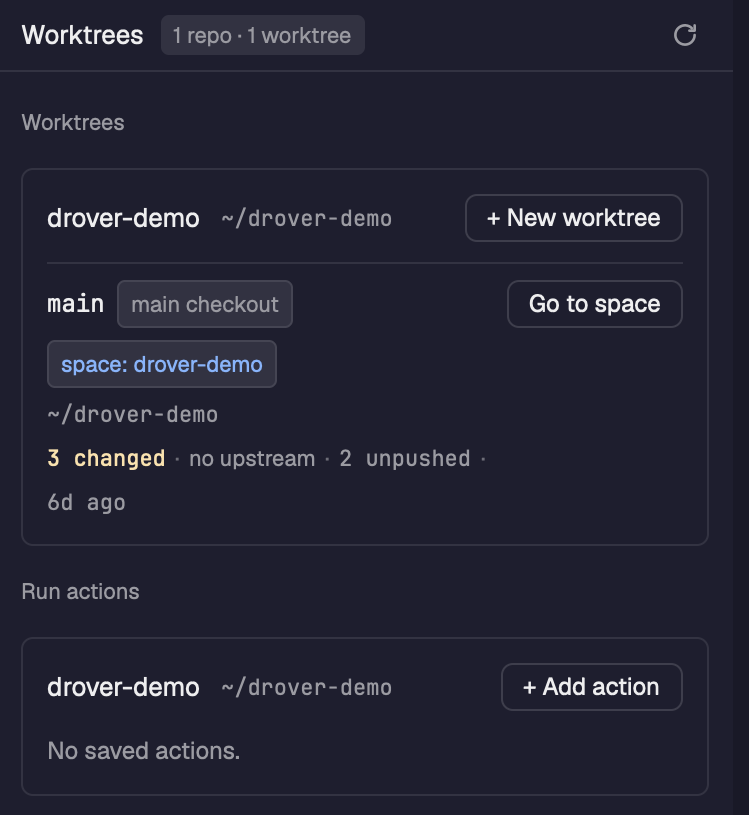

# drover-worktrees

A dialog of the git worktrees behind your open spaces, one section per repository. Each worktree shows its branch, whether it is clean, how far it is from its upstream, its pull request and the space and agents on it. You can make a new worktree with its own space, open a space on an existing one, remove one that is safe to remove, and keep a short list of commands per repository to run with one click.

## What you see

A 1000 by 680 dialog with a Worktrees header and a Refresh button. Each repository gets a section, also for spaces on another machine. Each worktree row has:

- the branch in a mono font, or `detached <sha>`, or `(bare)`;
- tags: "main checkout", "PR #12 open" (green, ansi2), merged (ansi5) or closed (ansi1), "space: <name>" in the accent color, the number of agents in the working color, and "locked";
- the path, cut from the left so the last two folders stay;
- facts: "clean" or "N changed" (yellow), `↑ahead ↓behind upstream` or "no upstream", "N unpushed", and the age of the last commit;
- "merged, can be removed" when the PR is merged and nothing blocks removal.

Under the repositories, a Run actions section has a card per repository with its saved commands and a "+ Add action" button, which asks for a name ("Name, e.g. Dev server") and a command ("Command, e.g. npm run dev"). Commands from the repository's `.claude/launch.json` are listed under them, read-only.

## How it behaves

- "+ New worktree" asks for a branch name and a base, which starts as the default branch. The line under the fields shows the folder it will use, `<repo>/.claude/worktrees/<name>`. Create runs `git worktree add` there, on a new branch or on the existing one as it is, then opens a new space on it. A name that would leave that folder is refused.
- Open space opens a space on a worktree. When one is open already, the button says Go to space and selects it.
- Remove asks for a second click within 6 seconds and shows the exact `git worktree remove <path>` it will run. It is not offered for the main checkout. It is blocked, with the reason spelled out, when the worktree is bare, locked, its folder is missing, it has uncommitted files or unpushed commits, either of those is unknown, or an agent runs there.
- Running a saved action opens a tab running `sh -c <command>` in that repository's space, or a new space when none is open. While that tab still runs the command, the action carries a "running" tag.
- Delete on a saved action needs a second click.
- It reads every 30 seconds and asks GitHub for pull requests every 60 seconds.

## Built from

One mod, `drover-worktrees`, `"place": "none"`, with a dialog overlay of 1000 by 680. Open it with `mod.open {name: "drover-worktrees"}` from a key you add to `keys.json`, or put it in a layout block.

What it touches:

- Network: `gh pr list --state all` for the PR tags. Nothing else.
- Programs: git (`rev-parse`, `worktree list --porcelain`, `status --porcelain=v2`, `rev-list --count HEAD --not --remotes`, `log -1`, `symbolic-ref`, `config` for remote URLs, `worktree add`, `worktree remove`), gh, and `sh -c` for your saved actions. Reads run on the machine the space lives on.
- `hc`: `get --json <terminal>` to see whether an action's tab is still running.
- Reads outside its folder: the repositories of your open spaces, and `<repo>/.claude/launch.json` if it exists, read-only.
- Writes: new worktrees under `<repo>/.claude/worktrees/`, and removal of the worktrees you confirm. Saved actions live in the shared state key `drover-worktrees.actions`. The running tabs are tracked in localStorage under `runs`.

## Watch out

- On Windows, creating or removing a worktree on this computer is refused with a one-line reason; the check for agents still working in a worktree matches `/` paths. Spaces on another machine work as usual.
- Worktrees always go under `<repo>/.claude/worktrees/`. Add that folder to the repository's `.gitignore` if you don't want it to show as untracked.
- Remove never forces. git refuses on its own if the tree changed between the check and the click.
- Without `gh`, rows simply have no PR tag.
- Actions run through `sh -c`, so your shell's aliases and functions are not there.

## Done when

- With a space open on a repository that has two worktrees, both show with their branches and the main one is tagged "main checkout".
- New with branch `fix-login` and base `main` creates `<repo>/.claude/worktrees/fix-login` and opens a space on it.
- Remove on a worktree with an uncommitted file shows "Can't remove: 1 uncommitted file".
- Remove on a clean, pushed worktree asks for a second click and then the row is gone.
- A saved action "Dev server" with `npm run dev` opens a tab running it in the repository's space.
