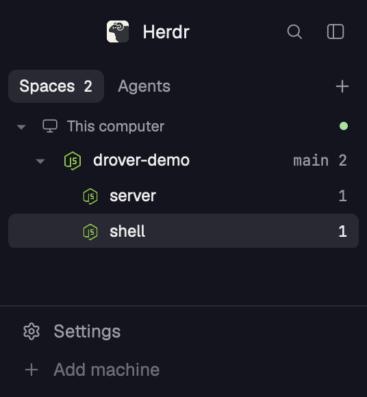
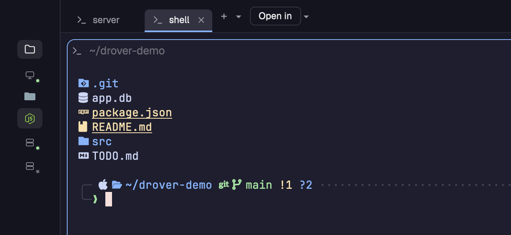
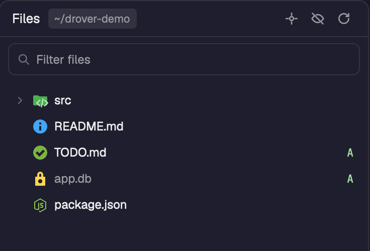
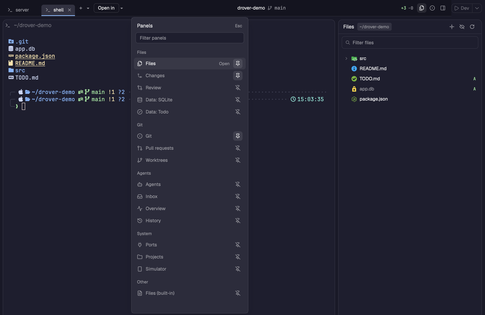
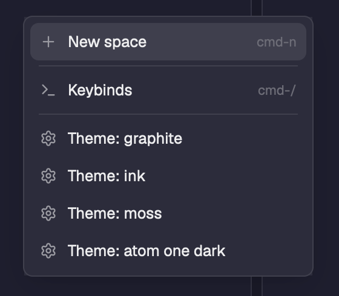

# drover

drover is a layout for [Herdr](https://herdr.dev), the terminal app built for running coding agents. It gives the window a sidebar of spaces and agents, a tab bar with a run button, a header on every pane, and a side panel you can switch between files, review, git, ports, pull requests and a few more panels.

The mods behind it also install one at a time. If you like your own layout, add the Git dialog or the port list to it and leave the rest.

The mods run on your machine, and on the machines you connected to Herdr. They call programs you already have, such as git, gh, lsof and sqlite3, and pass their arguments as lists. A shell only runs a fixed script or a command you saved yourself. Anything that deletes, merges, pushes, stops a process or sends one message to several agents waits for a second click.

## Screenshots

The spaces sidebar, and the same sidebar folded down to a rail of icons:





The Files panel, with a filter box and git marks next to each file:



The Panels list behind the buttons at the right of the tab bar, where you pick and pin side panels:



The terminal menu, with new space, keybinds and the themes:



## Install

Paste the line into an agent running inside Herdr. It reads Herdr's own instructions and copies the files into `~/.config/herdr-app`, merging any keys. Your current layout stays as it was.

The whole layout:

<!-- install -->
<!-- /install -->

Single items:

drover-git, a Git dialog for branches, merges, pushes and pull requests. It brings drover-viewer, drover-open and drover-files along.

<!-- install:drover-git -->
<!-- /install -->

drover-viewer, a file viewer and editor pane with an "Open with" chooser and a file tree.

<!-- install:drover-viewer -->
<!-- /install -->

drover-data, a SQLite browser and a TODO.md board for the focused folder.

<!-- install:drover-data -->
<!-- /install -->

drover-ports, every listening TCP port with its process, its Herdr space, and Open and Stop buttons.

<!-- install:drover-ports -->
<!-- /install -->

drover-pulls, the open pull requests of your open spaces, with CI and review state.

<!-- install:drover-pulls -->
<!-- /install -->

drover-worktrees, the git worktrees behind your spaces, with New, Remove and saved run commands.

<!-- install:drover-worktrees -->
<!-- /install -->

drover-review, a narrow panel of changed files with viewed marks and the files your agent touched.

<!-- install:drover-review -->
<!-- /install -->

drover-overview, every agent on every machine by state, plus CPU, memory, GPU and ports per machine.

<!-- install:drover-overview -->
<!-- /install -->

drover-composer, one message sent to a terminal or to several agents at once.

<!-- install:drover-composer -->
<!-- /install -->

drover-dispatch, pick a GitHub issue and get a worktree, a space and two panes for it.

<!-- install:drover-dispatch -->
<!-- /install -->

drover-agents, the setup and token usage of the coding-agent CLIs on this computer.

<!-- install:drover-agents -->
<!-- /install -->

drover-sim, a Simulator panel that shows an iOS Simulator or an Android emulator and passes your taps and typing through to it. It brings drover-sim-screen along.

<!-- install:drover-sim -->
<!-- /install -->

Each folder has a RECIPE.md that describes the item and what it runs.

## Requirements

You need Herdr. drover is built and used on macOS. Tests cover the Linux and Windows code paths with stand-in tools, but nobody has run them on those systems yet, and they have the limits listed below. On macOS the tab row leaves room for the window buttons. On Linux and Windows it draws its own minimize, maximize and close buttons.

Keys: every drover shortcut is a `cmd` chord on macOS. Linux and Windows get a Ctrl chord next to each one, because Herdr reads `cmd` as the Super or Windows key there. `cmd-X` becomes `ctrl-shift-X` and `cmd-shift-X` becomes `ctrl-alt-shift-X`, so Go to is `ctrl-shift-k` and Git is `ctrl-alt-shift-g`. `cmd-alt-X` also moves to a `ctrl-alt-shift` chord, because on Windows Ctrl+Alt is AltGr and types characters on many keyboard layouts: Open with is `ctrl-alt-shift-w`, Open in is `ctrl-alt-shift-i`, History `ctrl-alt-shift-y` and Simulator `ctrl-alt-shift-s`. In `keys.json` these extra chords are written with `secondary`, for example `secondary-alt-shift-v`, and `secondary` is Cmd on macOS. So macOS gets them too: Cmd+Alt+Shift chords that do the same as the Cmd ones, and `ctrl-shift-k`, which opens Go to instead of reaching the terminal. Keys inside a single panel, such as save in the viewer, also use `secondary`. The panel keys that were `cmd-alt` stay so on macOS and are `ctrl-alt-shift` elsewhere. If a chord clashes with something you use, change it in `keys.json`.

The tools each item calls, on macOS and Linux:

- drover (the layout): git, python3, lsof and ps. gh for pull requests and Dispatch, sqlite3 for the Data panel, xcrun or adb for the Simulator panel. zoxide and ripgrep are used when present.
- drover-git: git. gh or glab to list pull requests; without them a button opens the forge page.
- drover-viewer: nothing beyond Herdr on macOS. `file` and ripgrep are used when present.
- drover-data: git, sqlite3, find and realpath.
- drover-ports: lsof and ps.
- drover-pulls: git and gh, logged in.
- drover-worktrees: git. gh adds pull request tags.
- drover-review: git, python3 and stat. The turns section reads Claude Code transcripts.
- drover-overview: on macOS sysctl, vm_stat, ps and lsof; on Linux /proc and ss (or lsof), and nvidia-smi for a GPU.
- drover-composer: nothing beyond Herdr.
- drover-dispatch: git and gh, logged in.
- drover-agents: python3 and git.
- drover-sim: for iOS, macOS with Xcode (`xcrun simctl`, and `xcrun swiftc` to build the live view helper on first use). For Android, `adb`.

On Linux, opening files and links needs `xdg-open` from xdg-utils. Move to Trash uses `gio trash` or `trash-put` from trash-cli, and with neither the menu item says what to install. drover-ports falls back to ss and ps when lsof is missing. iOS simulators need macOS, so the Simulator panel shows Android only, at about one frame a second.

On Windows, install Git for Windows and put its `usr\bin` folder on PATH next to git, gh and Herdr's `hc`. Many mods use the `sh`, `env`, `stat`, `find`, `wc`, `tail`, `sed` and `cp` from there. Files and links open with `explorer.exe`. A path with a comma is not opened or shown in Explorer, because Explorer reads the comma as a separator, and a file that Windows would run as a program, such as a script or installer, is not opened; you can copy the path instead. Move to Trash sends the item to the Recycle Bin through PowerShell. Windows would delete an item for good when it can't keep it, so the menu says it can't move the item to the Recycle Bin and leaves it alone in those cases: on a network share or a removable drive, when that drive's Recycle Bin is set to delete files at once, when the item is at least as big as the Recycle Bin, or when the Recycle Bin settings can't be read. Where a tool is missing, the panel says what it needs. Some parts do not work on Windows yet, and the panel says so:

- drover-viewer: opens no file without the Git for Windows tools above.
- drover-git: fetch, pull and push run git through `env`.
- drover-files: the quick filter needs `sh` and `find`. Network folders (`\\server\share`) are not shown.
- drover-open: no editor rows, and `C:\` paths are not looked up.
- drover-projects: folders on this computer are not listed. Other machines are.
- drover-arrange: reading the split layout needs `sh` and `hc`.
- drover-data: the SQLite and TODO views need find and realpath.
- drover-dispatch: setting up a worktree is refused.
- drover-worktrees: creating and removing a worktree on this computer is refused. Spaces on another machine work.
- drover-history: the "This space" filter. All spaces works. The indexer runs with `py -3` or `python`.
- drover-ports and drover-overview: listening ports come from netstat and tasklist, with no folder, CPU or memory. Stop asks the process to close and does not force it, so many console programs stay running.
- drover-agents and drover-review: both read transcripts with Python. drover-agents tries `py -3` and then `python3`. Files whose type Windows would run as a program, network paths and paths with a comma are not opened from it; it offers Copy path instead.
- drover-sim: Android only, as on Linux.
- The sidebar shows project icons as a plain folder and favicons as letters.

## License

MIT, see [LICENSE](LICENSE). A few mods started as copies of mods that ship with Herdr, which is Apache-2.0. Those folders keep the Apache text in LICENSE-APACHE and say in NOTICE which parts came from where. The icon sets keep their own LICENSE and NOTICE files.

## How this repo is built

The folders here are generated. The mods live in a Herdr config folder, and `node scripts/export.mjs` copies them out:

```sh
node scripts/export.mjs                # reads ~/.config/herdr-app
node scripts/export.mjs --src <dir>    # reads another config folder
```

The script never writes to the config folder. It writes the layout (`layouts/drover.json`, `keys.json`, `mods/`, `themes/`) and one folder per single item, and leaves out local mods that are not part of drover. It copies the text in `docs-src/` into place, where `README.src.md` becomes `README.md` and `RECIPE.src.md` becomes `RECIPE.md`, and fills in the install lines. Last, it removes files it no longer writes and runs `scripts/leak-gate.mjs`, which fails the export when a private name or path slipped in.

So don't edit a generated folder by hand. Change the mod in Herdr, try it there, and export again. The two themes in `themes/` are not copied by the installer; put one in your own themes folder if you want it.
