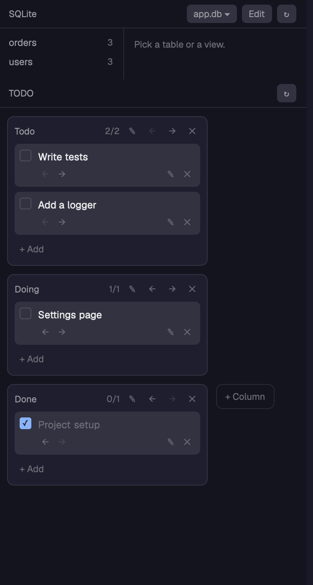

# drover-data

Two panel views for the focused space's folder. SQLite lists the database files in that folder and shows their tables a page at a time, read-only unless you switch Edit on. TODO turns the folder's TODO.md into a board with one column per `##` heading and one card per `- [ ]` line.

## What you see

The panel is 420px wide by default and uses the layout's chrome background. Its header says SQLite or TODO.

SQLite lists the `.db`, `.sqlite` and `.sqlite3` files in the folder, at most 50, none over 2 GB. Pick one and its tables and views appear. Pick a table and its rows show 100 to a page, with Previous and Next. A text cell shows its first 200 characters and a blob shows as `<blob N bytes>`.

TODO shows the columns side by side. Lines before the first heading go in a Todo column. A card shows its checkbox, its text and its notes. With no TODO.md the view says so and offers Create TODO.md, which writes three empty columns: Todo, Doing and Done.

A space on another machine shows "Remote space: this panel reads local folders only."

## How it behaves

- Edit is off every time the panel mounts and every time you switch databases. Switched on, it lets you insert a row, change one cell, set a cell to NULL, delete a row, create a table, add or rename a column, rename or drop a table, and create a new database. Deleting a row or dropping a table needs a second click, and the button says how many rows go with the table.
- Enter saves an edit and Esc cancels it.
- On the board you can tick a box, add, edit, delete and move a card to the previous or next column, and add, rename, move or delete a column. Each change reads TODO.md again, checks that the lines it drew are unchanged, and only then writes. If they changed, nothing is written and the board reloads with the note "TODO.md changed; reloaded". Deleting a column asks again and says how many cards go with it.
- A TODO.md with bytes that are not UTF-8 shows read-only.
- A light 1 second timer notices a new space or folder. It reads files no faster than every 15 seconds, and not at all while the panel is hidden or the window is in the background.

## Built from

One mod, `drover-data`, `"place": "none"`, size 420. `props.view` picks the view: `"sqlite"` (the default) or `"todo"`. In a layout it sits in a block such as `{ "mod": "drover-data", "props": { "view": "todo" } }`. As a tab: `tab.new {mod: "drover-data", props: {view: "todo"}}`.

What it touches:

- Network: none.
- Programs, all with argument lists:
  - `git ls-files -co --exclude-standard -z` to list files;
  - `find` for the top-level listing and size and type checks;
  - `sqlite3 -readonly -init /dev/null -json <file> <one SELECT or PRAGMA>` to read;
  - `sqlite3 -init /dev/null -bail -json <file> <one write>` in Edit mode only;
  - `realpath` so a file behind a symlinked folder is never opened.
- `hc`: none.
- Reads outside its folder: the focused space's folder.
- Writes: the database you edit and TODO.md, each on a click or Enter. Nothing else.

## Watch out

- Every write is one guarded statement built from quoted identifiers. Free SQL is not accepted.
- A table's rows are fetched with a byte budget, so a wide table shows fewer than 100 rows per page.
- If the schema changes while you edit, the view says "Schema changed; reloaded" and drops the edit.
- New database names get `.sqlite` added unless they end in `.db`, `.sqlite` or `.sqlite3`.
- A heading that ends in `#` keeps it, so `## C#` stays a column named C#.

## Done when

- A folder with `app.db` lists it, and picking a table shows its first 100 rows.
- With Edit off, no cell can be changed.
- With Edit on, changing a cell and pressing Enter writes it, and the row shows the new value after a reload.
- The TODO view on a folder without TODO.md offers Create TODO.md, and after a click the board has Todo, Doing and Done.
- Ticking a card's box changes `- [ ]` to `- [x]` in the file.
- Editing TODO.md in another editor and then ticking a box on a card that moved writes nothing.
