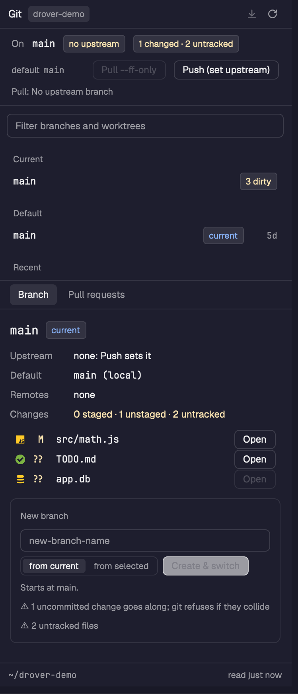

# drover-git

A Git dialog for the repository you are working in. It opens at 1100 by 720 over the window and shows the current branch, the default branch, recent and remote branches, worktrees and pull requests. You can switch, fetch, pull, merge, push and start a branch from it. Conflicted files open in drover-viewer, which comes with this item together with drover-open and drover-files.



## What you see

The dialog follows the repository of the focused pane. When that pane has no folder it takes the focused agent's folder, then the active space's folder. A folder outside any repository says so.

- Current: the branch, its upstream, how far ahead and behind it is, and how many files are uncommitted.
- Default: the remote's HEAD, else `origin/main` or `origin/master`, else a local `main`, `master` or `develop`, else `init.defaultBranch`. The dialog shows where the answer came from.
- Recent branches from the reflog, All local, Remote (with a filter box that takes words in any order), and Worktrees.
- A branch's detail: its last commit, ahead and behind against the current branch, which worktree has it checked out, and links to its branch, compare and pull request pages on GitHub, GitLab or Bitbucket.
- A Pull requests tab, filled by `gh pr list` on GitHub and `glab mr list` on GitLab. Without the tool, a button opens the forge's list in your browser.

The other three mods:

- drover-viewer opens a file in a pane. Markdown gets a preview and a Source tab, code gets an editor with syntax colors, images show as images, files over 1 MiB open as a read-only window of 2,000 lines.
- drover-open is the "Open with" chooser for a link, a path or any text.
- drover-files is a file tree that follows the focused pane's folder and opens files in drover-viewer.

## How it behaves

Every write is checked again first. The dialog reads the repository fresh (a read older than 10 seconds is refreshed) and refuses during a merge, rebase, cherry-pick or revert, with conflicts, on a detached HEAD, and while an agent in this repository is working.

- Switch runs `git switch -- <branch>`, or `git switch --track <remote>/<branch>` for a remote-only branch. A dirty tree asks for a second click.
- Fetch runs `git fetch <remote>` with no prompts and a 30 second limit. Pull fetches, then merges with `--ff-only`.
- Merge shows how many commits come in, then needs two clicks.
- Push needs two clicks and warns on the default branch. With no upstream it runs `git push -u <remote> <branch>`.
- New branch runs `git switch -c <name> <base>` from the current or the selected branch.
- Abort merge needs two clicks. Auto-merge on GitHub runs `gh pr merge <n> --auto` after a fresh `gh pr view`, also after two clicks.
- When a merge stops, the dialog lists the conflicted files. Ask agent shows the exact prompt, and only a second click sends it. Copy prompt puts it on the clipboard instead.

Keys from this item's `keys.json`:

- `cmd-shift-g` opens Git, `cmd-alt-o` opens Open with (and reads the clipboard again while it is open).
- In the viewer: `cmd-s` save, `cmd-e` next view, `cmd-r` reload, `ctrl--` back, `cmd-alt-r` revert.
- In the file tree: `cmd-alt-f` filter, `cmd-shift-.` show or hide `.git`, `node_modules` and `.DS_Store`, `cmd-alt-p` stop or start following focus, `cmd-r` refresh.

## Built from

Four mods, all `"place": "none"`. `drover-git` opens with `mod.open {name: "drover-git"}` as a dialog, or as a page with `tab.new {mod: "drover-git"}`, and `props.cwd` pins it to a folder. `drover-viewer` takes `{path, line?, on?}`, `drover-files` takes `{folder?, reveal?, on?}`, `drover-open` takes `{target, cwd, on, pane}`.

What it touches:

- Network: git fetch, pull and push, `gh` and `glab` calls, all with `GIT_TERMINAL_PROMPT=0`, so a call that would ask for a password fails with a short message instead. Links open in your browser, http and https only.
- Programs: git, gh, glab, an optional Bitbucket helper you configure, `file`, rg or grep, ls, sh with fixed scripts, mv, mkdir, `/usr/bin/trash`, `open`. Each gets an argument list. git.js refuses `--force` and its forms, `-f` and `-D`, `+` and `:` refspecs, `--delete`, `--mirror`, `--no-verify`, `reset`, `clean` and `worktree remove` before anything starts.
- `hc`: only `send`, when you click Ask agent a second time.
- Reads outside its folder: the repository, the files you open, `data/drover-git/settings.json` if you made one, and `mods/drover-viewer/mod.json` to see if the viewer is installed.
- Writes: Git writes only through the git actions above. The viewer saves when you press Save and keeps drafts and an image cache in `data/drover-viewer/`. Open with keeps your last choice per kind in `data/drover-open/prefs.json`. Files creates, renames and trashes only on a click.

Optional `data/drover-git/settings.json`:

```json
{
  "forgeHosts": { "git.example.com": "gitlab" },
  "bitbucketHelper": ["my-bb-tool", "prs", "{workspace}", "{repo}", "--host", "{host}"],
  "fetchPrune": false
}
```

## Watch out

- `fetchPrune` is off by default, so Fetch never deletes remote-tracking refs.
- The Bitbucket helper must print a JSON array of `{ id, title, author, source, target, state, url }` within 15 seconds. It gets no tokens from the mod.
- Credential files (`.env*`, keys, `.ssh`, `.aws`, `.netrc`, `*.sqlite`, `*.db` and similar) are never opened by the viewer, the chooser or the tree, also when a harmless name links to one.
- Error text has URL user info stripped and secrets masked.
- Files on another machine open read-only in the viewer.
- Move to Trash needs `/usr/bin/trash`, which macOS has from version 15. Without it the menu item is hidden.

## Done when

- `cmd-shift-g` in a repository opens the dialog with the current branch, its upstream and its ahead and behind counts.
- Typing two words in the Remote filter in reverse order still finds the branch.
- Switch on a dirty tree asks for a second click.
- Push on a branch without upstream runs `git push -u` and the branch then shows its upstream.
- A merge with a conflict lists the conflicted file, and clicking it opens drover-viewer.
- `cmd-alt-o` with a path on the clipboard offers Open in viewer.
