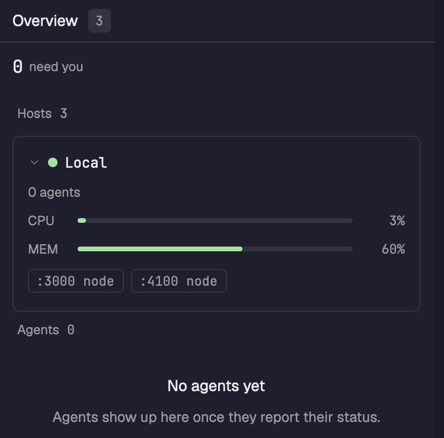

# drover-overview

Every agent on every machine in one view, sorted by what it needs from you, and a card per machine with its CPU, memory, GPU and listening ports. From a row you can reply to an agent, mark a finished one as settled, or snooze it for a while.

## What you see

The header says Overview with the number of machines. Under it a summary line counts the agents that need you, then done and working ones when there are any.

Hosts: one card per machine, Local for this computer. A dot shows the connection (green ready, yellow loading, red unavailable), then the number of agents. Open cards show meters for CPU, MEM, and on Linux with an NVIDIA card GPU and VRAM, colored by load. CPU only shows when some machine is busy. Up to six port chips follow, as in `:3000 node`, and a `+N` for the rest. A click on the card's name folds it.

Agents: groups in this order, each with its count: Needs you, Done, Working, Idle and Snoozed. Inside a group, the one waiting longest comes first. A row shows a status mark that reads without color (a triangle for needs you, a spinner for working, a filled dot for done, a ring for idle, a z for snoozed), the program's icon, the tab or agent title, the space and program, the branch, the machine when it is not this one, and how long ago the state changed. The Snoozed group starts folded.

## How it behaves

- A click on a row focuses that agent's pane.
- Hovering a row, or focusing its agent, swaps the branch for buttons: Reply, Settle on a done agent, and Snooze, or Wake on a snoozed one.
- Reply opens a field in the row. Enter sends the text with `hc send --force`, so it reaches an agent that waits on a prompt. Esc cancels.
- Settle moves a done agent to Idle until it finishes another turn.
- Snooze offers 15 min, 1 hour and Tomorrow (9:00 local). A blocked agent always shows under Needs you, snoozed or not.
- Metrics refresh every 5 seconds and ports every 15, only while the view is on screen. With the window in the background it slows to every 30 seconds.
- Folded hosts, the Snoozed fold and the state change times are kept in localStorage under `folded`, `snoozed-open` and `changed`.

## Built from

One mod, `drover-overview`, `"place": "none"`, with a popup overlay at the top, 1100 wide and 80% tall. In the drover layout it is a page of the panel. Elsewhere, open it with `mod.open {name: "drover-overview"}` from a key you add to `keys.json`.

What it touches:

- Network: none of its own. Remote machines are read through Herdr's link to them.
- Programs, on each machine, with a 4 second timeout:
  - `uname -s` once;
  - macOS: `sysctl -n hw.memsize hw.ncpu`, `ps -A -o %cpu=`, `vm_stat`, and `lsof +c 0 -nP -iTCP -sTCP:LISTEN` for ports;
  - Linux: `cat /proc/stat /proc/meminfo /proc/loadavg`, `nvidia-smi` for the GPU, and `ss -ltnp` for ports, or lsof when ss is missing;
  - Windows, this computer only: `netstat -ano` and `tasklist /FO CSV /NH` for listening ports. There is no CPU, memory or GPU reading, and the card says so.
- `hc`: `label <agent> snoozed=<time>` and `settled=<time>:<turn>`, and `send --force -- <agent> <text>` for a reply.
- Reads outside its folder: nothing beyond what those programs report.
- Writes: the two labels above on the agent's terminal. Nothing on disk.

## Watch out

- A missing tool leaves that meter out. A machine without `nvidia-smi` or `ss` stops being asked after the first miss.
- Snooze and settle are terminal labels, so drover-inbox and other mods that read them agree with this view.
- Reply uses `--force`. Read what the agent asks before you send.

## Done when

- With an agent blocked on a permission prompt, it is listed first under Needs you with a triangle.
- Reply on that row, with some text and Enter, puts the text in that agent's terminal.
- Snooze, 15 min moves a done agent to Snoozed, and it comes back after 15 minutes.
- The Local card shows MEM and the dev server ports running on this computer.
