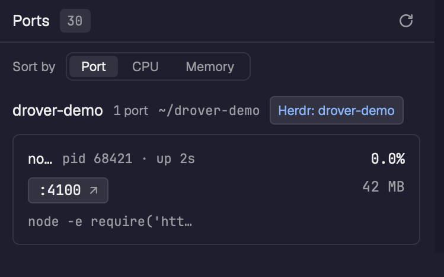

# drover-ports

A dialog of every TCP port listening on this computer. Each row shows the port, the process behind it, its CPU and memory, how long it has run, and the Herdr space it was started from. Rows are grouped by the folder the process runs in. A click on a port chip opens it in the browser, and Stop ends the process after a second click.



## What you see

A 920 by 640 dialog. Processes are grouped by their working folder. A process whose folder is your home folder or `/` goes into a System group, listed last. Long paths keep their tail, as in `…/parent/name`, and are never cut in the middle.

Each row has the process and its command, one 22px chip per listening port, CPU, memory, run time, and a "Herdr: <space>" badge when the process runs in a Herdr terminal. A sort control switches between Port, CPU and Memory.

## How it behaves

- A port chip opens `http://localhost:<port>` with `open` on macOS, `xdg-open` on Linux and `explorer.exe` on Windows.
- Stop appears when you hover or select a row. It turns into "Confirm stop" for 4 seconds. The second click checks that the process still holds the port (`lsof -t` on macOS and Linux, `netstat -ano` on Windows), then sends `kill -TERM`, or `taskkill /PID <pid>` on Windows. It never signals pid 1 or lower.
- Up and Down move the cursor, Enter opens the first port of the row, Esc clears the cursor.
- The list refreshes every 15 seconds while the window is active.
- The sort choice is kept in the mod's localStorage under `sort`.

## Built from

One mod, `drover-ports`, `"place": "none"`, with a dialog overlay of 920 by 640. Open it with `mod.open {name: "drover-ports"}`, for example from a key you add to `keys.json`:

```json
{ "global": { "cmd-alt-l": "mod.open:drover-ports" } }
```

On Linux and Windows `cmd` is the Super or Windows key, so pick a Ctrl chord there instead, such as `ctrl-alt-shift-l`.

It also works as a block in a layout.

What it touches:

- Network: none. A port chip asks the system to open a localhost URL in your browser.
- Programs, with argument lists:
  - `lsof -iTCP -sTCP:LISTEN -nP` for the ports;
  - `ps -ww -o pid=,pcpu=,rss=,etime=,command= -p <pids>` for the processes;
  - `lsof -a -d cwd -p <pids> -Fn` for their folders;
  - `ps -axo pid=,ppid=` to walk up to a Herdr shell;
  - `open`, `kill -TERM`, and `lsof -t` before a stop.
  - On Linux the same, with `xdg-open` to open. Without lsof it reads `ss -ltnp`, `ps` and `pwdx` instead.
  - On Windows, `netstat -ano` and `tasklist /FO CSV /NH`, `explorer.exe` to open, and `taskkill /PID <pid>` after a fresh netstat check. Windows shows no folder, CPU or uptime, and taskkill does not force, so many console programs refuse to close and the page says so.
- `hc`: `get --json <terminal>` to match a shell to its space.
- Reads outside its folder: nothing beyond what those programs report.
- Writes: nothing. The sort choice lives in localStorage.

## Watch out

- It sees this computer only. Ports on a remote machine of a space do not show.
- The key in the example is not bound by default. Pick one that is free in your `keys.json`.

## Done when

- With a dev server running on port 3000 in a Herdr space, the dialog shows it under the project's folder with that space's badge.
- Clicking the 3000 chip opens the page in the browser.
- Stop asks for a second click, and after it the port is gone on the next refresh.
- Sorting by Memory puts the largest process first and the choice is still there after reopening.
