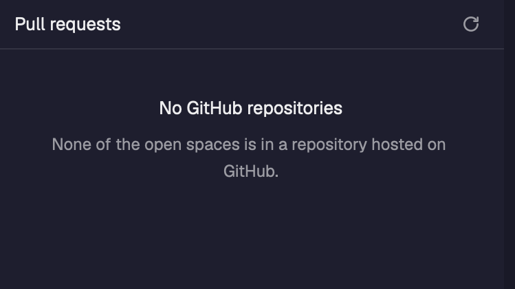

# drover-pulls

A dialog of the open pull requests in the GitHub repositories behind your open spaces. It shows yours and the ones waiting on your review, with CI and review state, stacked PRs under their base, and buttons to open a PR, jump to the space that has it checked out, turn on auto-merge, or hand a failing CI run or review comments to the agent on that branch.

## What you see

A 1000 by 680 dialog. At the top, three filters: Mine, Review requested and All open. The list is grouped by repository, each group headed by its name and the spaces that hold it. Each row shows the number, the title, a draft tag, a tag for the space that has the branch, the branch, the review decision in color, a CI label (red for failing, yellow for pending, green for passing, using the theme's ansi1, ansi3 and ansi2) and the age. A PR built on another PR's branch shows a prefix that places it in its stack.

The detail on the right lists Checks, Review, Unresolved, Mergeable, Auto-merge, Draft and On branch, then the buttons.

Empty states say what is missing: "gh isn't installed", "Could not reach GitHub", "No GitHub repositories", or a line per filter such as "Nothing waiting on your review."

## How it behaves

- Open opens the PR page, and only a github.com PR URL.
- Go to space selects the space and tab that have the branch checked out, then closes the dialog.
- Enable auto-merge turns into "Confirm auto-merge (squash)" (or merge, or rebase, whatever the repository allows) for 5 seconds. The second click checks the PR again with `gh pr view` and then runs `gh pr merge <n> --repo <repo> --auto --<method>`.
- Ask agent to fix CI and Send review comments to agent show the prompt on the first click and send it on the second. They work only when exactly one agent sits on that branch.
- Up and Down move the cursor, Enter opens that PR's detail, Esc closes the detail. The header's Refresh asks GitHub right away.
- It polls every 5 seconds but asks GitHub at most once a minute per repository, and only while the dialog is open or the block is on screen.
- The filter is kept in the mod's localStorage under `filter`.

## Built from

One mod, `drover-pulls`, `"place": "none"`, with a dialog overlay of 1000 by 680. Open it with `mod.open {name: "drover-pulls"}` from a key you add to `keys.json`, or put it in a layout block.

What it touches:

- Network: GitHub, through `gh` only. The mod never sees your token.
- Programs:
  - `git --no-optional-locks remote -v` in each open space's folder to find github.com remotes;
  - `gh api user --jq .login`;
  - `gh pr list --repo <repo> --state open --limit 100 --json ...` and a `review-requested:@me` search;
  - `gh api graphql` for merge settings and review threads;
  - `gh pr view` and `gh pr merge --auto` for auto-merge;
  - `open <url>` for Open.
- `hc`: `send <agent> <text>`, only on the second click of an agent button.
- Reads outside its folder: the git remotes of your open spaces.
- Writes: nothing on disk. The filter lives in localStorage.

## Watch out

- Only github.com remotes count. GitLab and self-hosted remotes are skipped.
- `gh` must be logged in. Without it the dialog shows the error from GitHub.
- At most 100 open PRs per repository are listed.
- An agent button stays disabled when no agent, or more than one, is on the branch, so the text never goes to the wrong one.

## Done when

- With a space open on a GitHub repository that has an open PR of yours, Mine lists it with its CI label.
- Go to space on that PR selects the space and closes the dialog.
- Enable auto-merge needs two clicks, and after the second GitHub shows auto-merge on.
- Ask agent to fix CI on a failing PR shows the prompt first and sends it to the agent on the second click.
