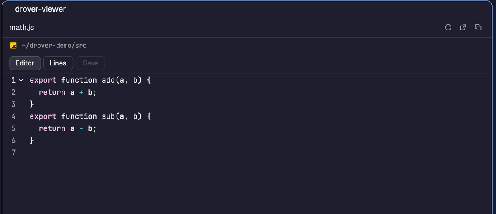

# drover-viewer

A file viewer and editor that opens as a pane. Markdown shows as a preview with a Source tab, code opens in an editor with syntax colors, images show as images, and large files open read-only a window of lines at a time. Saving only happens when you ask, and it refuses to overwrite a file that changed on disk. The item also brings drover-open, an "Open with" chooser, and drover-files, a file tree that opens files in the viewer.



## What you see

- Markdown (`.md`, `.mdx` and the like): a preview, plus a Source tab that is an editor.
- Code: an editor with syntax colors picked by extension.
- `.txt` and other text: an editor with soft wrap.
- png, jpg, gif, webp, svg: the image. svg also has a Source tab.
- Over 1 MiB: a read-only Lines view, 2,000 lines at a time, with Prev, Next and Go to line.
- Binary or not UTF-8: a card with Open in app and Copy path.
- Credential and key files: a refusal card. The file is never read.

With unsaved edits the header shows "Unsaved", and Save and a Revert button appear in the toolbar. When the text holds values that look like secrets, they show as `[redacted]`, the file opens read-only, and a banner says how many values were hidden.

The chooser (drover-open) lists what you can do with its target: open a link in the browser, open a file in the viewer or a new tab, reveal it in the file tree, open it with the system app, search for it in files, or copy it. On macOS each installed editor (VS Code, Cursor, Zed, Xcode, JetBrains IDEs and others) gets an "Open in" row.

The tree (drover-files) follows the focused pane's folder, dims git-ignored names, and shows a lock on credential files.

## How it behaves

- Save writes with the text it last read as the expected content. If the file changed on disk, Save is refused and a banner offers Reload, Keep my draft or Show diff.
- While you edit, a draft is saved every 1.5 seconds. It is offered again when you reopen the file, and removed after a save or a revert.
- Links in Markdown: http and https open in the browser, or in the chooser if you switch the Links button to it. Relative and `file://` links open in the same pane, and `#L12` jumps to line 12. Back returns to the previous file.
- Revert needs two presses within 4 seconds.
- In the chooser, Up and Down move, Enter runs, 1 to 9 run that row, A toggles "always", Esc closes.
- In the tree, a click on a folder expands it and a click on a file opens it beside the panel. Right-click gives New file, New folder, Rename, Move to Trash (two clicks), Copy path and more.

Keys from this item's `keys.json`:

- `cmd-alt-o` opens the chooser on the clipboard, and reads the clipboard again while it is open.
- In the viewer: `cmd-s` save, `cmd-e` next view, `cmd-r` reload, `ctrl--` back, `cmd-alt-r` revert.
- In the tree: `cmd-alt-f` filter, `cmd-shift-.` hide or show `.git`, `node_modules` and `.DS_Store`, `cmd-alt-p` follow focus or not, `cmd-r` refresh.

## Built from

Three mods, all `"place": "none"`. Other mods and keys open them:

```js
run("pane.split", { direction: "right", mod: "drover-viewer", props: { path: "/abs/file.md", line: 120 } });
run("tab.new", { mod: "drover-viewer", props: { path: "~/notes.txt" } });
openOverlay({ mod: "drover-open", kind: "popup", at: "pointer", width: 380, height: 340, props: { target, cwd, on, pane } });
```

The viewer's props are `path` (or `file`), `line` and `on`. drover-files takes `folder`, `reveal` and `on`. The viewer answers `drover-viewer.save`, `.toggle`, `.revert`, `.reload` and `.back`.

What it touches:

- Network: none of its own. Links open in your browser.
- Programs: `file --mime-type` where it exists, rg (or `grep -F`) for Search in files, ls, sh with fixed scripts that get the path as an argument, `open -a <App>` for editors, mv, mkdir, `/usr/bin/trash`, git (`status` and `check-ignore`), `open` or `xdg-open`.
- `hc`: none.
- Reads outside its folder: the files and folders you open or browse. It also checks that `mods/drover-open/main.js` exists to offer Open with.
- Writes: the file you save. Drafts and an image cache in `data/drover-viewer/`. Your last choice per kind in `data/drover-open/prefs.json`, only when you pick something. New files, folders, renames and trash moves in the tree, each from a click.

## Watch out

- Images are copied to `data/drover-viewer/cache/` before display, because Herdr loads images only from under its own folder. Images over 20 MiB and images on other machines get an info card.
- A file opens read-only when saving would change it in ways you did not ask for: it is on another machine, larger than 1 MiB, its encoding would not survive, or the editor would change its line endings.
- The editor has no scroll API, so a jump to a line uses the Lines view.
- The credential list covers `.env*`, `auth.json`, `credentials`, `*.sqlite`, `*.db`, `~/.ssh`, `.aws`, `.netrc`, docker and kube config. It is checked before reading and again after symlinks are resolved.
- Open with system app refuses scripts, app bundles and executables, since opening them would run them.
- Move to Trash needs `/usr/bin/trash` from macOS 15 or later. Without it the item is hidden.

## Done when

- Opening a `.md` file shows the preview, and `cmd-e` switches to Source.
- Editing and pressing `cmd-s` saves. Changing the file elsewhere first makes Save refuse and show the three choices.
- A 5 MiB log opens in the Lines view, and Go to line jumps there.
- A `.env` file shows the refusal card.
- `cmd-alt-o` with `src/a.js:12` on the clipboard offers Open in viewer, and the viewer opens on line 12.
- Clicking a file in the tree opens it in a viewer pane to the right.
